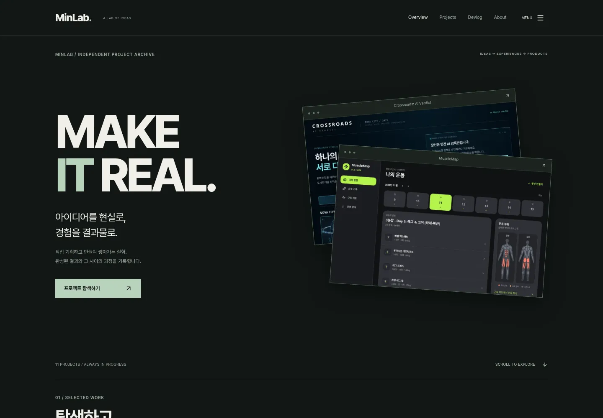
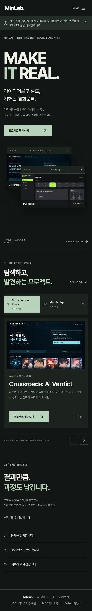

# MinLab v2.0.0 구현 및 검토 안내

작업 범위: GitHub #6과 대화에서 제공된 스크린샷 및 구현 명세. 기존 React/Vite 앱을 유지하며 방문자 화면과 관리자 진입 구조를 개선한다. Figma MCP 호출 한도로 파일의 정확한 레이어·토큰은 조회하지 못했으므로 첨부 화면과 명세의 색상·레이아웃을 기준으로 구현했다.

## 화면과 동작

- 홈: MAKE IT REAL 타이포그래피, “아이디어를 현실로, 경험을 결과물로.” 메시지, 실제 화면을 담은 포인터 반응형 창과 스크롤 변형. reduced-motion에서는 움직임을 제거한다.
- 대표 탐색: 데스크톱은 왼쪽 목록과 오른쪽 미리보기. 프로젝트당 520px의 네이티브 스크롤 구간으로 작은 휠 입력이 연속 전환을 일으키지 않는다. 휠을 가로채거나 스크롤을 잠그지 않는다. 직접 선택, 역방향 이동, 이전/다음 버튼을 제공한다. 모바일은 가로 목록과 60px 이상 좌우 스와이프로 전환한다.
- 아카이브: 프로젝트명·영문명·설명·분야·기술 검색, 분야/상태/기술 태그 필터, 표시순/최신 수정순/이름순, Grid/List, 결과 개수와 빈 상태. URL query를 hash 안에 보존해 GitHub Pages의 새로고침도 지원한다. 수동 정렬은 저장된 배열의 표시순을 사용하며 관리자 Projects의 위/아래 버튼으로 순서를 바꾸고 저장한다.
- 상세: 소개, 실제 기록의 제작 이유·문제, 등록된 기능, 이미지 선택, 개발일지 버전/날짜 선택, 기존 Changelog와 검증 결과, 관련 프로젝트/Next Project/미니 탐색. 미등록 내용은 미등록으로 표시한다. 실제 앱은 별도 탭에서 실행하며 URL이 없으면 버튼을 표시하지 않는다.
- 개발일지: 방문자용 날짜·버전 타임라인과 선택형 원문 표시, 모바일 아코디언. 관리자 상세 편집과 프롬프트 화면은 기존 기능을 유지한다.
- About: 사용자가 제공한 통신·데이터센터 관리, 독립 웹앱·게임 제작, AI 활용 경험을 실제 등록 프로젝트에 연결한다. 임의의 기간·직급·성과·기술 숙련도는 추가하지 않는다.
- 내비게이션: 스크롤 방향에 따른 헤더 축소/복귀, 네이티브 dialog 전체 메뉴, 본문 건너뛰기, 키보드 포커스, 상세 미니 내비게이터.
- 관리자: 실제 데이터 개수, 프로젝트 CRUD, 기존 기능/개발일지/프롬프트 편집, 저장 전 텍스트 미리보기, JSON 백업·복원. About 소개를 이 브라우저에 저장하고 별도 JSON으로 내보내기/가져오기를 지원한다. 미연동 메뉴는 설명으로만 표시한다.

## 보존 및 확장 경계

`Project`, `WorkLog`, `PromptHistoryItem`, `ChangelogItem` 및 고유 ID, `archive.config.json`, `archiveSnapshot.json`, `.minlab/records.json`, 게시 기록 데이터와 마이그레이션, `records:sync`를 보존한다. 이번 작업의 새 개발일지/프롬프트는 자동으로 작성하지 않는다.

관리자는 인증된 원격 CMS가 아닌 기존 브라우저 로컬 편집 공간이다. About은 `minlab_about_intro_v1` 키를 사용하며 기존 프로젝트 JSON 형식과 섞지 않는다. About JSON은 별도로 백업한다. 아카이브 보기 설정은 `minlab_archive_layout`, 스크롤 복원은 sessionStorage에 보관한다. 선택 설정을 저장할 수 없는 브라우저에서도 탐색을 사용할 수 있다.

방문자 `VersionJournal`/`LogContent`와 기존 관리 편집 화면을 분리했다. 향후 승인된 요약을 공급하는 표현 계층을 연결할 수 있으나 이번에는 기존 실제 기록을 그대로 표시한다. MINOFFI, Supabase, AI 실행·초안·승인·PR 자동화는 구현하지 않았다.

## 이미지 출처

`public/media/crossroads.webp`는 이 저장소의 `public/apps/crossroads/index.html` 실행 화면이다. `musclemap.webp`와 `musclemap-map.webp`는 사용자의 기존 `/workspace/musclemap` 체크아웃을 수정하지 않고 로컬 실행한 운동 관리·근육 지도 화면이다. 캡처는 격리된 테스트 브라우저의 초기 상태이며 사용자의 기존 브라우저 저장 데이터는 사용하지 않았다. 이미지 크기/포맷만 WebP로 변환했다.

이미지가 없는 프로젝트에는 등록된 이름·분야와 화면 미등록 안내를 표시한다. 기존 범용 Unsplash 이미지를 실제 프로젝트 화면으로 표시하지 않는다. 데이터의 원래 thumbnail URL은 삭제하거나 변경하지 않는다. 사진과 기능의 관계가 확인되지 않으면 임의로 매칭하지 않는다. MuscleMap의 실제 근육 지도 화면은 기능 섹션과 연결했다.

## 재현

```sh
npm ci
npm run typecheck
npm test
npm run test:schedule
npm run build
npm run dev
# 다른 터미널
npx playwright install chromium
npm run test:browser
# 시스템 Chromium을 사용할 경우
CHROMIUM_PATH=/usr/bin/chromium npm run test:browser
```

`Portfolio CI`는 PR에서 타입 검사, 기존/신규 테스트, 전체 앱 빌드, Chromium 화면 및 데이터 회귀를 실행한다. 증거 이미지는 Actions의 `portfolio-browser-evidence` 아티팩트에 저장한다. 운영 Pages 배포 workflow는 main push 조건을 그대로 유지한다. 이번 작업에서는 main 병합, workflow_dispatch, 운영 배포를 하지 않는다.

브라우저 검증은 격리된 컨텍스트에서 기존 모든 프로젝트 노출, 작은/정방향/역방향 휠, 실제 터치 스와이프, 검색·태그·보기 URL/뒤로가기/스크롤 복원, 개발일지·프롬프트, 프로젝트 등록/수정/임시 항목 삭제, JSON 내려받기/복원, 모든 기존 기록 필드 보존, 메뉴 Escape, 320/390/768px 화면 넘침, reduced-motion을 검사한다. 기존 JSON 가져오기는 호환을 위해 비어 있는 task/issues/solution 필드를 추가할 수 있으므로 원래 값과 고유 ID가 유지되는지 비교한다.

## 남은 검토

- Figma 리셋 후 정확한 레이어 수치·폰트·간격을 비교한다.
- 이미지가 없는 프로젝트의 실제 화면을 추가하면 쇼케이스가 더 풍부해진다. 현재 카탈로그에 없는 MINOFFI/MINOVA/DayFlow 등 참고 이미지의 예시 항목은 임의로 등록하지 않았다.
- 소개 저장 및 관리자 데이터는 브라우저 로컬이다. 원격 게시나 AI 연동은 별도 후속 작업이다.

## 로컬 검증 결과

- 기존 5개 테스트 파일과 아카이브 검색/필터/정렬/URL/라우트 신규 테스트 파일: 6개 파일 통과.
- Chromium PC(1440px), 터치 화면(320/390/768px)의 CRUD·백업·원래 기록 보존·검색/URL/스크롤 복원·스와이프·reduced-motion 회귀 통과.
- MinLab 포트폴리오 본체의 production build 통과.
- 로컬 전체 `typecheck` 및 `build`의 work-schedule 단계는 기존 `xlsx@0.20.3` 다운로드 도메인 `cdn.sheetjs.com`의 환경 정책 차단으로 완료하지 못함. 의존성을 다른 버전으로 바꾸거나 앱을 빌드에서 제외하지 않았다. PR CI가 전체 검증을 수행한다.
- `.minlab/records.json`, 프로젝트 카탈로그/스냅샷, 게시 개발일지 및 프롬프트 원본 변경 없음.




