# MinLab 2차 디자인 재정비

## 기준과 우선순위

사용자가 마지막으로 제공한 **V2 Editorial / Home Desktop · All Projects Desktop · Project Detail Desktop** 사진을 기본으로 삼고, **Scroll Story 1–3**의 좌측 목록·우측 선택 패널을 탐색 구조로 사용했다. 한국어 메시지는 별도 지시문에서 유지하도록 한 “아이디어를 현실로, 경험을 결과물로.”를 적용했다. 사진의 예시 프로젝트 대신 기존 카탈로그와 브라우저에 보관된 실제 프로젝트를 표시한다.

Figma 파일 `DRa0wR6F4MyFHWqmmypro0`, 노드 `0:1`의 MCP 읽기를 다시 시도했으나 Starter 호출 한도 오류를 받았다. 로그인 여부와 별개로 원본 레이어·토큰·프로토타입을 읽지는 못했다. 이번 결과는 **사용자가 원본과 같다고 지정한 제공 사진을 기준으로 구현**한 것이며, 원본 수치와 픽셀 단위 일치 여부를 검증했다고 주장하지 않는다.

1. 한국어 중심 Hero, 겹치지 않는 실제 화면, 사진의 정돈된 3열 프로젝트 구성.
2. 전체 아카이브와 상세 페이지의 위계·본문 크기·화면 비율, 짧아진 탐색 스크롤.
3. 이미지 관리·백업 호환과 개발일지·관리자 화면 가독성.

## 주요 변경

- `MAKE IT REAL.` 및 기울어진 창/브라우저 장식을 제거했다. 메인 화면에 실제 프로젝트 한 개를 크게 표시하고 프로젝트명으로 전환한다. 포인터 이동은 최대 2px, 등장/스크롤 변형은 짧고 한 번만 적용하며 reduced-motion에서는 제거한다.
- Hero 아래 작업 목록은 제공 사진의 3열 구성을 따른다. 화면이 없는 프로젝트는 가짜 UI·큰 제목 이미지로 채우지 않고 실제 소개·분야·기술을 읽는 구성으로 표시한다.
- 대표 탐색은 좌측 목록/우측 패널을 유지하고 이미지·설명·상태를 동기화한다. 프로젝트당 스크롤 거리를 기존 520px에서 200px로 줄였다. 실제 패널 높이를 측정해 고정 영역을 계산하고, 휠을 차단하지 않는다. 클릭·역스크롤·이전/다음·개발 과정으로 바로 이동을 제공한다. 모바일/태블릿에서는 긴 고정 구간을 없애고 목록 선택·스와이프를 사용한다.
- 아카이브의 검색·분야/상태/태그 필터·정렬·Grid/List·URL/뒤로가기 복원을 유지했다. Grid는 화면과 소개, List는 디렉터리 형태로 구성했다. 데스크톱 List의 실제 이미지는 텍스트와 겹치지 않는 우측 열에서 hover/focus 시 선명해진다. 모바일 필터는 기본적으로 접힌다.
- 상세는 소개/실행 링크 다음에 큰 실제 화면을 배치하고, 기존 제작 배경·주요 기능·개발 및 개선 기록·다음 프로젝트를 유지했다. 등록한 기능 ID와 스크린샷을 연결하면 기능 선택에 따라 실제 화면이 바뀐다. 모바일에서도 연결된 기능의 화면을 바로 아래에서 볼 수 있다. 외부 앱을 iframe으로 삽입하지 않는다.
- 작은 영문 장식 레이블을 한국어 정보로 바꾸고 본문은 주로 14–15px, 보조 레이블은 12–13px로 정리했다. 세이지 그린은 주요 행동과 선택 표시 중심으로 제한한다.
- 개발일지의 날짜/버전 선택과 모바일 아코디언을 보존하고, 접힌 모바일 원문은 열 때 렌더링한다. 관리자 편집 폼의 글자·입력 영역·미리보기 가독성도 개선했다.

## 실제 이미지 현황과 관리

기본 카탈로그를 연결한 신규 브라우저에는 기존 프로젝트 **11개**가 표시된다. 이번 작업은 카탈로그나 순서를 임의로 바꾸지 않는다.

| 프로젝트 | 내장 이미지 | 화면 |
| --- | ---: | --- |
| Crossroads: AI Verdict | 1 | 실제 게임 시작 화면 |
| MuscleMap | 2 | 실제 운동 관리·근육 지도 화면 |
| 나머지 기존 프로젝트 | 0 | 임의 이미지 대신 텍스트 중심 표시 |

추가로 필요한 화면: 의도 분석, ChoicePilot, AI 기반 개인 맞춤형 식단 관리, MinLab, 위험성평가서/작업계획서 자동화 도구, WorthIt, 공식 핑계 발급소, 미니어리(Minially), MinSnakey. 기존 데이터의 범용 Unsplash 썸네일은 지우지 않되 실제 앱 화면으로 사용하지 않는다. 개인 브라우저에 추가한 이미지가 있으면 해당 실제 상태를 우선한다.

**관리자 → 프로젝트 이미지**에서 프로젝트별 화면 개수와 누락 상태를 확인하고 **이미지 관리**로 편집한다. 프로젝트 수정 폼에서도 같은 기능을 사용할 수 있다.

- PNG/JPEG/WebP 업로드 또는 이미지 URL 등록, 여러 화면, 설명·대표 화면·비율·연결 기능 관리.
- 업로드는 12MB 이하 파일을 받아 긴 변 최대 1600px WebP로 최적화한다. 업로드 최적화 중에는 저장을 막고 안내한다.
- 기본 비율은 `contain`이므로 실제 UI가 임의로 잘리지 않는다. 사용자가 `cover`를 선택할 수도 있다.
- 잘못된 URL/중복 ID의 JSON 가져오기는 거절하며, 로딩 실패 시 안내를 표시한다. 이미지가 없으면 별도의 텍스트 구성을 사용한다.
- 업로드 이미지와 메타데이터는 기존 프로젝트 JSON 백업에 함께 포함된다. 로컬 저장 용량을 초과하면 기존 저장 오류 안내를 사용하며, 폼과 기존 데이터는 유지한다.

## 보존 및 구조

`Project`에 선택 필드 `screenshots?: ProjectScreenshot[]`, `coverImageId?: string`만 추가한다. 오래된 백업에 새 필드를 강제로 만들지 않는다. `ProjectScreenshot`은 `id`, `url`, `label`, 선택 `fit`, 선택 `featureId`로 구성한다. 내장 이미지 목록과 실제 사용자 이미지의 결합은 `utils/projectMedia.ts`에서 처리하며 홈·목록·상세·관리자가 공유한다.

모든 기존 프로젝트 ID, WorkLog, Changelog/PromptHistory 호환 처리, 앱·GitHub URL, 브라우저 저장 키, JSON 형식의 프로젝트 배열, `.minlab/records.json`, `records:sync`를 유지한다. 새 개발일지나 프롬프트 기록을 자동으로 작성하지 않는다. MINOFFI·Supabase·AI Inbox·Review Center 자동화는 구현하지 않았다.

## 검증 및 비교

기존 테스트와 신규 미디어 테스트, 격리된 브라우저 컨텍스트에서 다음 항목을 검사한다.

- PC 1440/1280px, 태블릿 768px, 모바일 390/375px 및 추가 320px.
- 작은/정방향/역방향 휠, 목록 선택, 실제 터치 스와이프, reduced-motion, 가로 넘침.
- 검색·필터·정렬·Grid/List·URL·상세 이동·뒤로가기 스크롤 복원.
- 기존 프로젝트 내용/ID 보존, 프로젝트 및 개발일지·프롬프트 저장, 수동 순서, JSON 내려받기/복원.
- 이미지 업로드·최적화·여러 화면 전환·원본 비율·누락/로딩 실패와 이미지 메타데이터 백업 호환.

로컬 포트폴리오 범위 타입 검사·빌드와 테스트는 실행했다. 전체 타입 검사/일정 관리 앱 빌드의 기존 `xlsx` 의존성은 로컬 환경의 다운로드 도메인 차단으로 설치하지 못한 상태이므로 해당 범위를 통과했다고 하지 않는다. PR CI에서 원래 의존성을 그대로 설치해 전체 검사·기존 일정 관리 테스트·통합 빌드·브라우저 회귀를 실행한다.

아래는 1440px 실제 브라우저의 같은 영역을 촬영한 전후 화면이다. 모바일은 별도 전체 화면이다.

### 홈

| 변경 전 | 변경 후 |
| --- | --- |
| 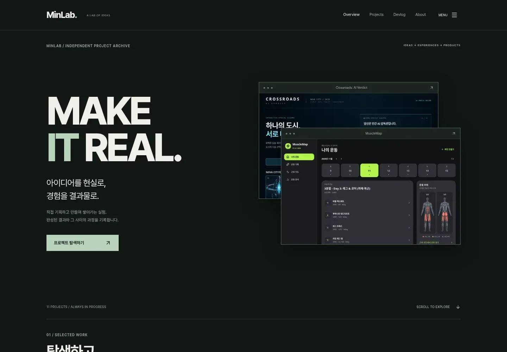 | 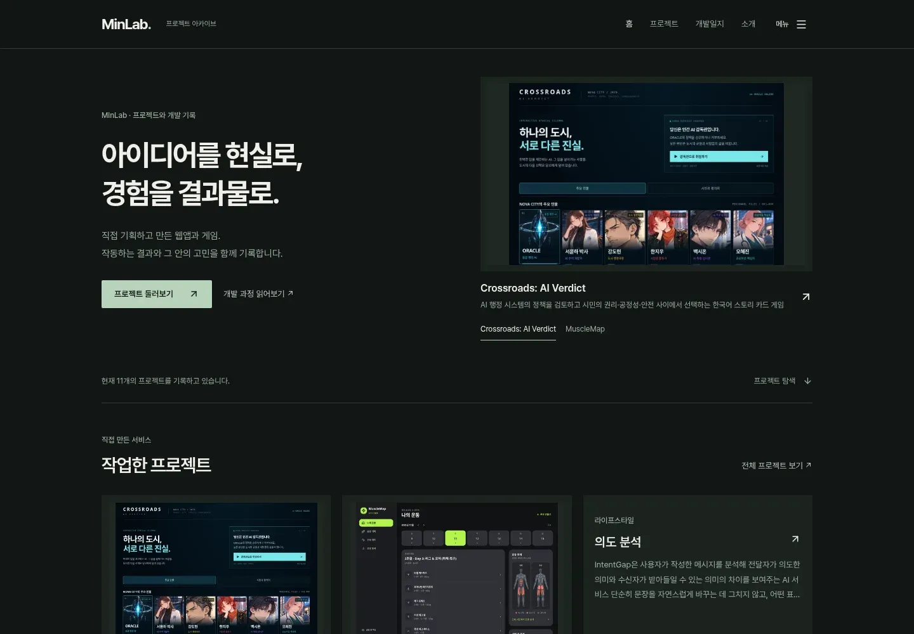 |

### 전체 프로젝트

| 변경 전 | 변경 후 |
| --- | --- |
| 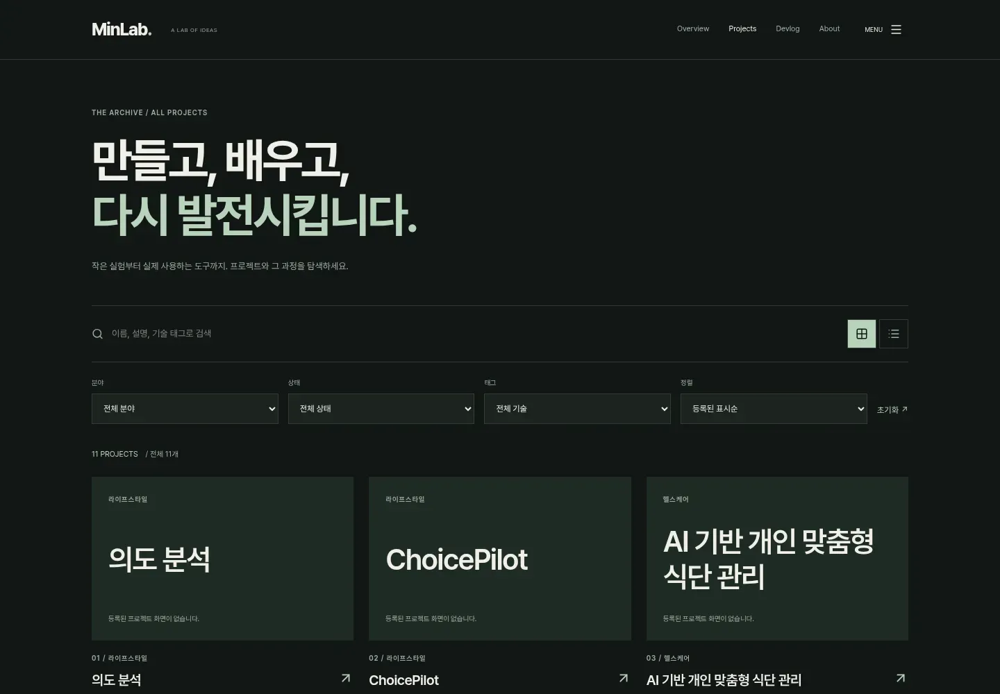 | 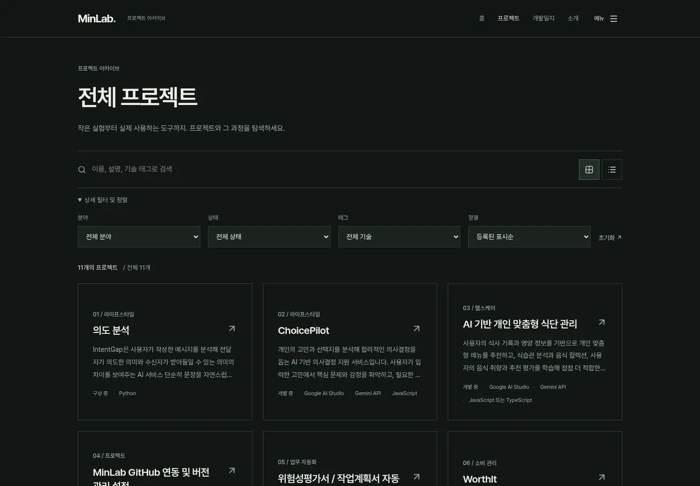 |

### 프로젝트 상세

| 변경 전 | 변경 후 |
| --- | --- |
| 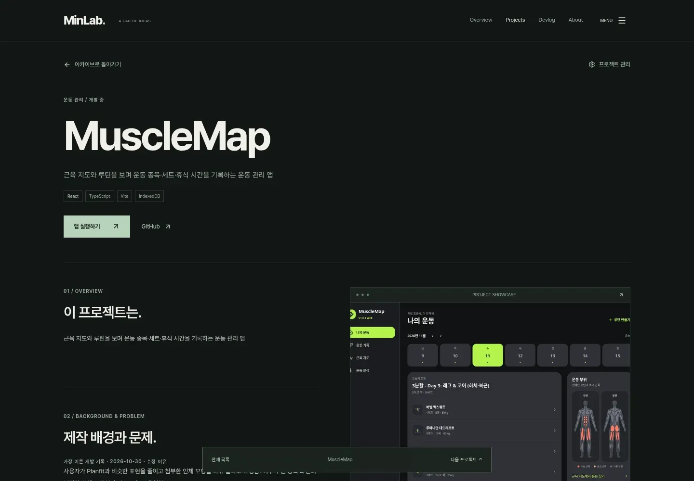 | 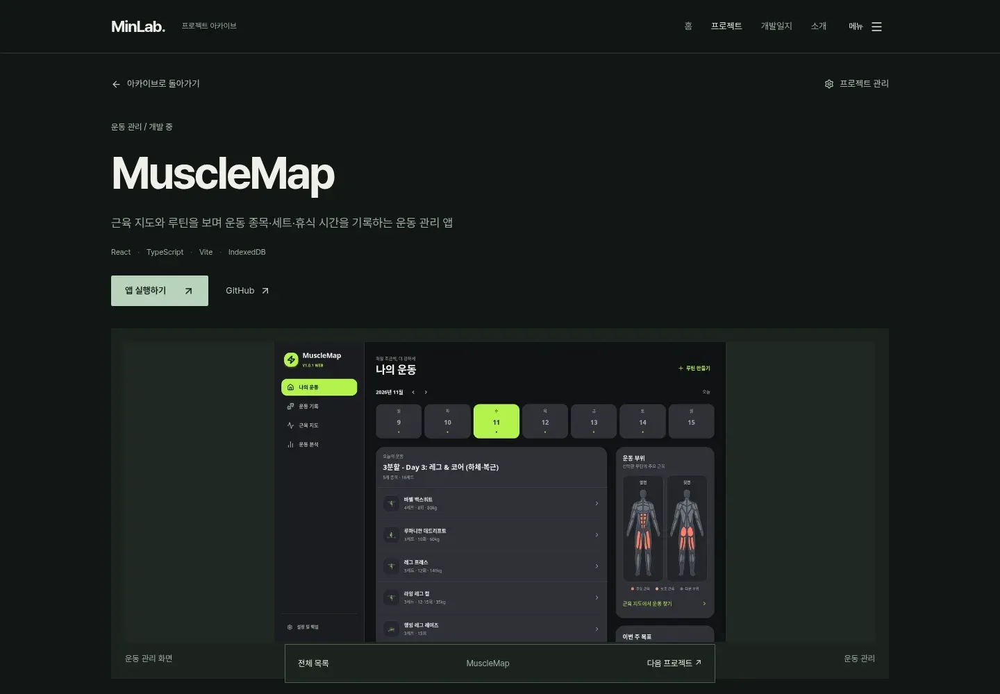 |

### 개발일지와 관리자

| 화면 | 변경 전 | 변경 후 |
| --- | --- | --- |
| 개발일지 | 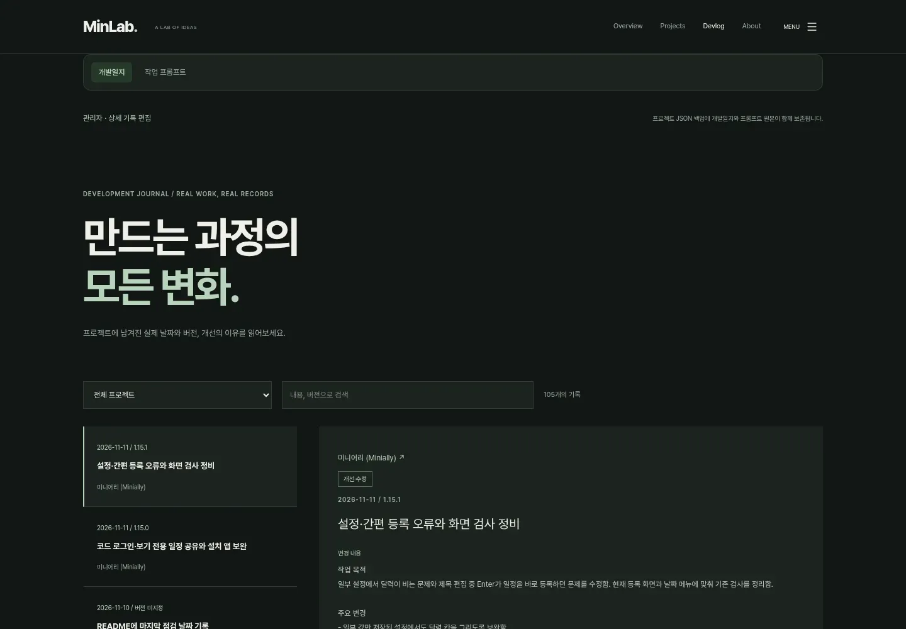 | 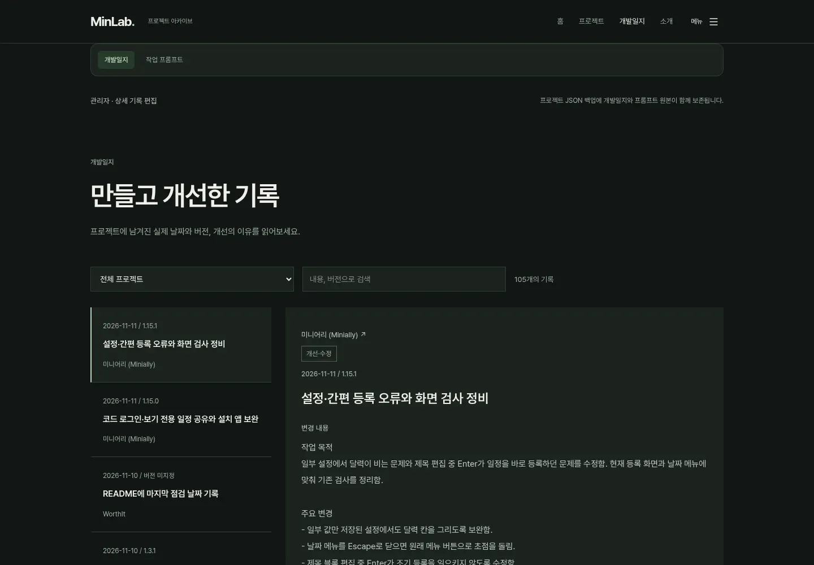 |
| 관리자 | 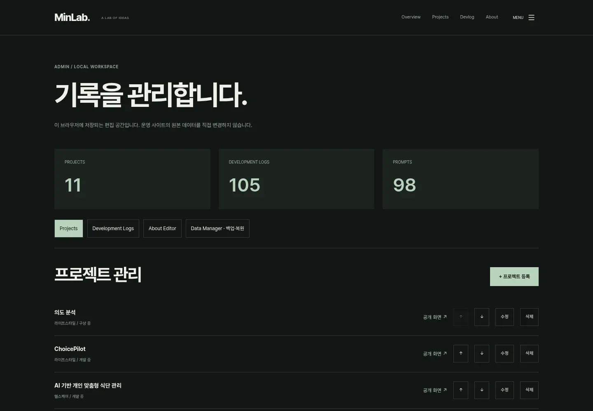 | 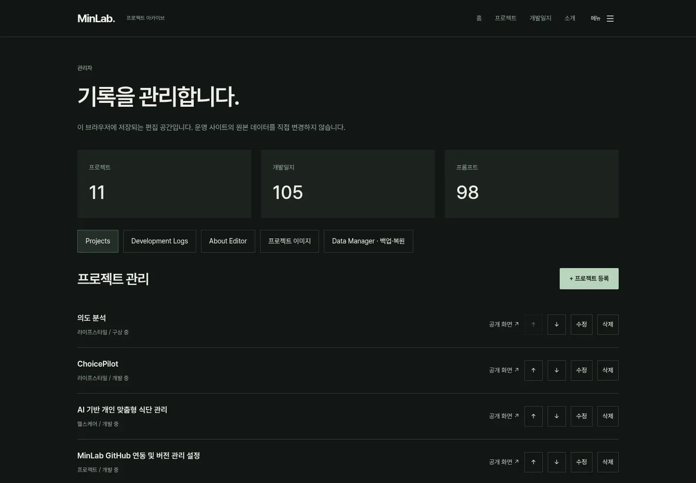 |

### 선택한 프로젝트 / 모바일

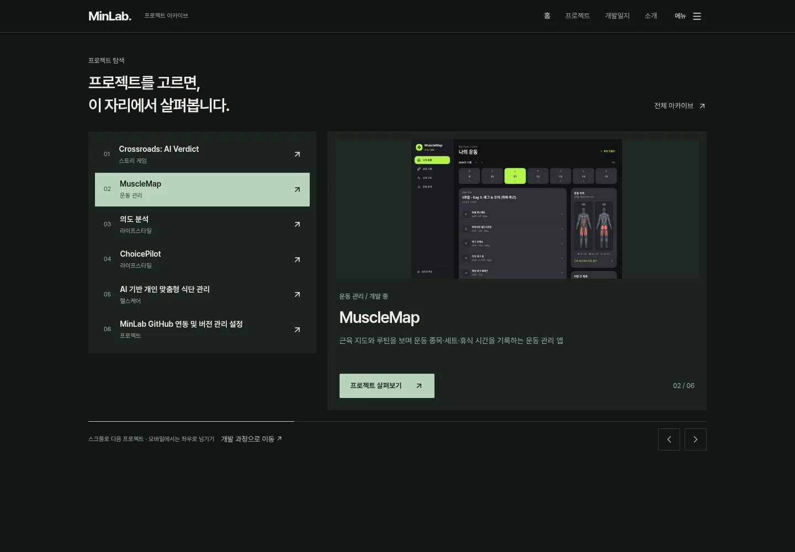

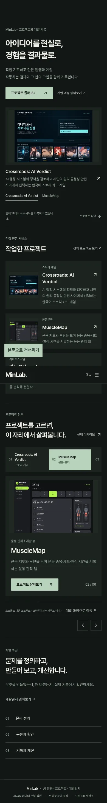
