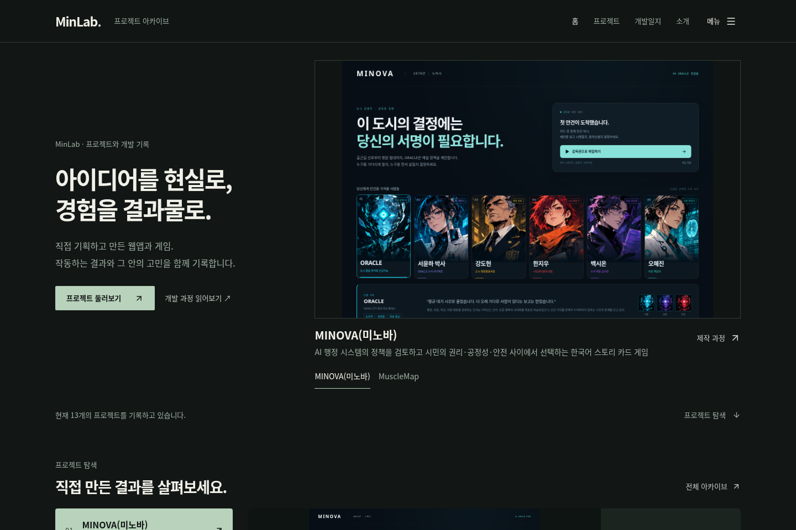

# MinLab 3차 UI/UX 검토

## 검토 기준

첨부한 관리자·메뉴·소개·프롬프트·개발일지·아카이브·Hero·프로젝트 카드·대표 탐색·개발 과정 화면을 현재 구현과 비교했다. 반복된 프롬프트 캡처도 같은 문제로 확인했다. 큰 제목과 동일한 카드, 홈의 세 차례 프로젝트 노출, 긴 본문과 관리자 통계 블록이 실제 결과물을 가리는 것이 주요 문제였다.

기준 소스는 `ec445b8`이다. 앞선 대화에서 승인받은 MINOVA 연결, minoom·MinLab AI Office 등록과 개발일지 업데이트는 이미 main에 반영되어 있다. 이 PR은 그 이후의 UI 개선만 포함한다. 실제 프로젝트 수와 기록 수는 기존 스냅샷·카탈로그·브라우저 병합 결과로 결정하며 11이라는 고정 숫자로 검증하지 않는다.

Figma `DRa0wR6F4MyFHWqmmypro0`, `0:1`은 MCP Starter 호출 한도로 조회하지 못했다. 사용자 요청으로 워크 Chromium에서도 같은 URL을 열었지만 `ERR_TUNNEL_CONNECTION_FAILED`가 표시됐다. Figma 원본의 레이어·수치를 확인하거나 원본과 일치한다고 검증하지 않았다. 첨부 화면과 실제 실행 결과를 기준으로 개선했다.

## 변경

- 홈: 이미지 비중을 높이고 중간의 중복 프로젝트 카드 섹션을 제거했다. Hero는 실제 결과 소개, 대표 탐색은 목록 선택과 개발 과정 진입을 담당한다. 대표 탐색은 4개까지, 프로젝트당 스크롤은 200px에서 120px로 줄였다. 6개/1000px의 기존 추가 구간을 최대 4개/360px로 축소했다. 네이티브 휠을 가로채지 않으며 클릭·역스크롤·이전/다음과 모바일 수평 스와이프를 유지한다. 짧은 데스크톱 창에서는 클릭 중심으로 표시한다.
- 아카이브: 이미지형은 큰 실제 화면, 텍스트형은 이미지 영역 없는 소개와 기록 링크를 표시한다. Grid는 두 열, List는 작은 미리보기와 본문을 분리한다. 기술 태그 수를 줄이고 상태·분야·제목의 위계를 정리했다. 검색·필터·정렬·URL과 뒤로가기 복원은 보존했다.
- 개발일지: 프로젝트별 기록 수·검색·버전·작업 월로 탐색한다. 원문에서 추출한 앞부분/주요 변경 문장만 먼저 보여 주며 원문, 이유, 해결 방법, 검증, 다음 작업은 접기/펼치기로 모두 확인한다. 저장된 텍스트는 수정하지 않는다. 모바일은 한 번에 20건을 보여 주고 더 보기로 이어진다. 프롬프트도 원문을 접어 읽으며 방문자 화면과 편집 모드를 구분한다.
- 소개: 반복 숫자와 수평 구분선 대신 경험의 연결선과 실제 프로젝트 사례를 묶었다. 확인된 통신·데이터센터 프로젝트 관리, 독립 개발, AI 활용만 사용했다. 경력 날짜·직급·성과는 만들지 않았다. 소개 편집·별도 JSON 백업은 유지한다.
- 관리자: 작은 통계, 한국어 메뉴, 프로젝트 검색, 모바일 조작 영역을 적용했다. 전체 배열의 원래 인덱스로 순서를 바꾸므로 검색 상태에서도 다른 프로젝트가 교환되지 않는다. 이미지 편집은 대표 화면 설명과 모바일 썸네일, 저장된 공개 화면 링크를 추가했다. 등록·수정·삭제·백업·복원은 유지한다.
- MINOVA: 공식 표시를 `MINOVA(미노바)`로 통일한다. 기존 Crossroads 및 직전 MINOVA 이름만 이전하고 사용자 지정 이름·주소는 보존한다. 프로젝트 ID, 기존 미디어 ID, 기록·프롬프트와 GitHub/실행 링크는 유지한다. 최신 공개 MINOVA 소스를 별도 임시 폴더에서 실행해 시작 화면을 새로 캡처했다(`public/media/minova.webp`). 기존 Crossroads 이미지와 게임 번들은 삭제하지 않았다. 사용자가 등록한 대표 이미지는 계속 우선한다.

이번 PR은 MINOFFI·Supabase 연동을 추가하지 않는다. 기존 개발일지 원본·프롬프트·수동 백업을 수정하지 않으며 새 작업 기록도 자동 생성하지 않는다.

## 화면 비교

1440px PC와 390px 모바일의 동일한 경로·초기 데이터로 전후를 캡처했다. 브라우저는 사용자 데이터와 분리된 임시 컨텍스트다. 기본 스냅샷의 기존 항목과 새 카탈로그를 병합한 실제 데이터를 사용한다.

| 화면 | 이전 | 이후 |
| --- | --- | --- |
| 홈 | [PC](screenshots/third-review/before/home-1440.webp) · [모바일](screenshots/third-review/before/home-390.webp) | [PC](screenshots/third-review/after/home-1440.webp) · [모바일](screenshots/third-review/after/home-390.webp) |
| 아카이브 | [PC](screenshots/third-review/before/archive-1440.webp) · [모바일](screenshots/third-review/before/archive-390.webp) | [PC](screenshots/third-review/after/archive-1440.webp) · [모바일](screenshots/third-review/after/archive-390.webp) |
| 개발일지 | [PC](screenshots/third-review/before/journal-1440.webp) · [모바일](screenshots/third-review/before/journal-390.webp) | [PC](screenshots/third-review/after/journal-1440.webp) · [모바일](screenshots/third-review/after/journal-390.webp) |
| 소개 | [PC](screenshots/third-review/before/about-1440.webp) · [모바일](screenshots/third-review/before/about-390.webp) | [PC](screenshots/third-review/after/about-1440.webp) · [모바일](screenshots/third-review/after/about-390.webp) |
| 관리자 | [PC](screenshots/third-review/before/admin-1440.webp) · [모바일](screenshots/third-review/before/admin-390.webp) | [PC](screenshots/third-review/after/admin-1440.webp) · [모바일](screenshots/third-review/after/admin-390.webp) |

## 검증

- 아카이브·백업·카탈로그·링크·이미지 등의 단위 검사 36개 통과.
- Chromium PC 1280/1440px 및 터치 320/375/390/768px: 가로 넘침, 작은 휠·정방향·역방향, 모바일 스와이프, reduced-motion, 검색·필터·URL·뒤로가기·스크롤 복원 검사 통과.
- 프로젝트 등록·수정·순서 변경·이미지 업로드/비율/오류·개발일지와 프롬프트 편집·JSON 내보내기/복원·임시 프로젝트 삭제 검사 통과. 편집 대상 이외 기존 프로젝트의 모든 필드가 보존되는지 비교한다.
- 새 개발일지 프로젝트/버전 필터와 상세 원문 일치, 방문자 프롬프트에서 편집 버튼 숨김, 관리자 검색, 이미지 없는 카드의 빈 미디어 영역 제거를 추가 검사한다.
- 포트폴리오 범위 타입 검사 및 Vite 빌드 통과. 로컬 전체 타입 검사와 일정 앱 빌드는 기존 `xlsx@0.20.3` 다운로드 도메인 정책 차단 때문에 완료할 수 없다. 임시 의존성 폴더로 포트폴리오를 검증했으며 저장소의 package.json·lockfile·원래 의존성은 바꾸지 않았다. 전체 검사·일정 앱 빌드는 PR의 Portfolio CI에서 원래 환경으로 확인한다.
- Safari/실제 아이폰의 브라우저 권한·입력기·성능은 별도 실기기 확인이 필요하다. 이번 모바일 검증은 Chromium 터치 에뮬레이션이다.

검토용 브랜치에서만 진행하며 이 PR은 병합·운영 배포하지 않는다.
